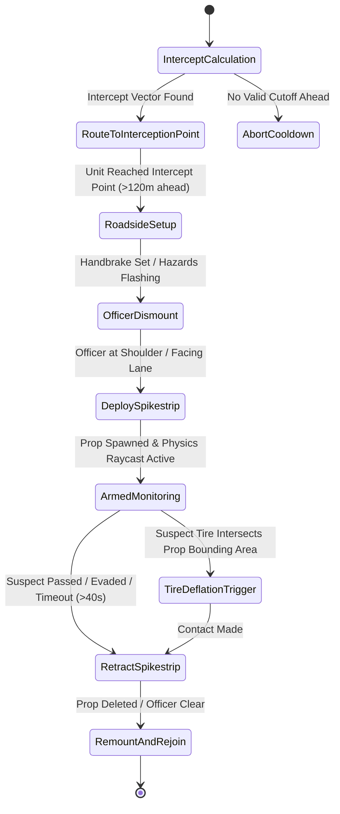
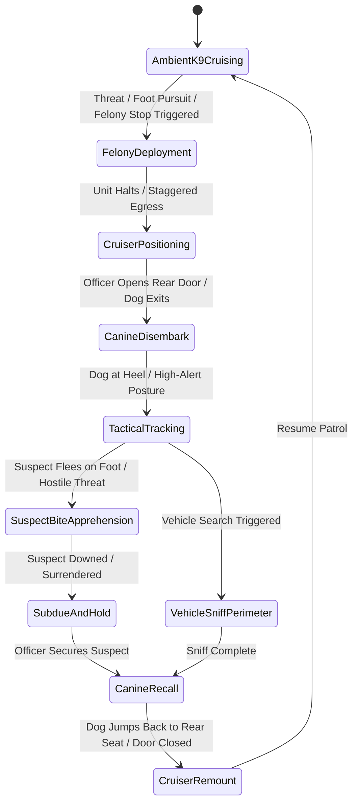
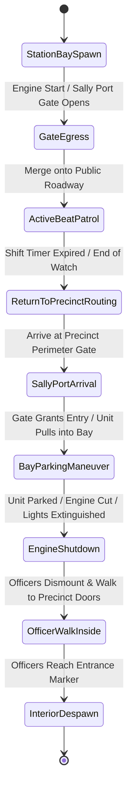
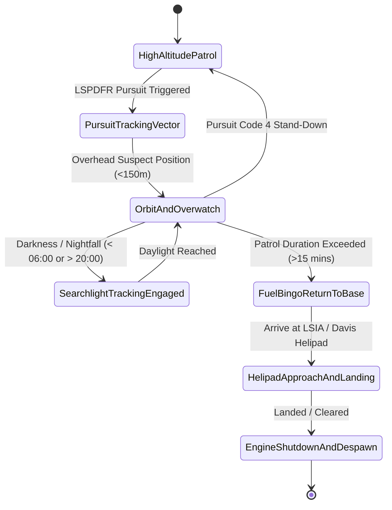
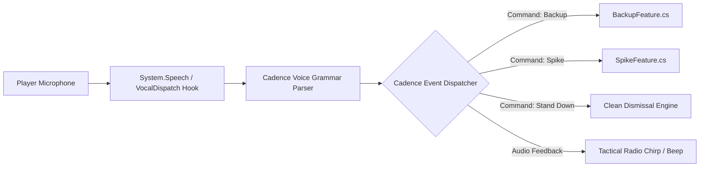
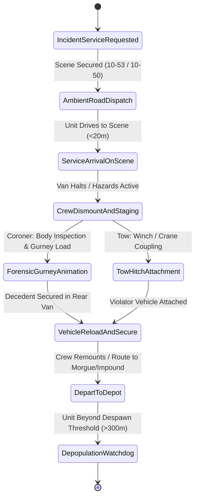
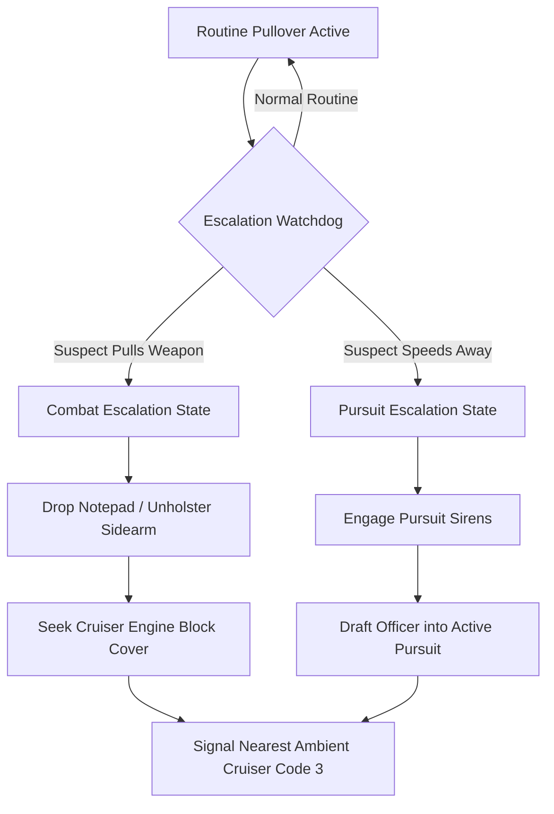

# Cadence - Future Features Architectural Blueprint & Roadmap

> **Target Version Horizon**: Post-v1.1.0 (v1.2.0 - v1.4.0)  
> **Architecture Pattern**: "Ponytail" Delete-Friendly Model  
> **Ecosystem Compatibility**: RagePluginHook (.NET Framework 4.8 / C# 10 / x64), LSPDFR 0.4.9+, Ultimate Backup, StopThePed

---

## 1. Strategic Development Freeze & Production Calibration Disclaimer

> [!IMPORTANT]
> **PRODUCTION FREEZE & CALIBRATION NOTICE (v1.1.0)**  
> Current active development on Cadence is **100% dedicated to production fine-tuning, runtime stability, absolute zero entity and blip leakage, and granular physical/AI calibration of existing features** in the v1.1.0 release branch.
> 
> Under no circumstances will new feature code branches be merged into the active release until the v1.1.0 Golden Master validation criteria are completely fulfilled across extended patrol sessions (4+ hours continuous operation under heavy ambient load).

### Release Readiness Invariants (v1.1.0 Golden Master Criteria)
1. **Zero Entity & Blip Leakage**: Comprehensive validation that every vehicle, officer ped, passenger ped, canine, and radar blip spawned by Cadence is tracked and safely disposed of via the atomic 4-step destructor protocol (`BlipService.SafeDeleteBlip`).
2. **Deterministic Memory Footprint**: No memory leaks in native unmanaged memory pools or managed CLR heap (`< 15 MB` sustained private working set for `Cadence.dll`).
3. **Zero Main Fiber Stall**: Strict enforcement of asynchronous background logging (`ThreadPriority.BelowNormal`) and non-blocking fiber yields (`0ms` synchronous game thread pause budget).
4. **Strict Fleet Protection**: Absolute zero unwanted fallback to vanilla GTA police vehicles (`police`, `s_m_y_cop_01`) when customized Ultimate Backup (UB) XML rosters are utilized (`Fallback = false`).
5. **Safe Road Node & Shoulder Calibration**: Flawless spawn placement across all 40+ curated highway zones in `ZoneSpawnData.cs` without subterranean void drops (`Z < -50.0f`) or road obstruction.

The blueprints presented in this document represent the formal design specifications for future releases (v1.2.0 and beyond). Every blueprint has been pre-architected under the **"Ponytail" Delete-Friendly Model**, ensuring zero structural lock-in and zero disruption to the hardened v1.1.0 core.

---

## 2. The "Ponytail" Delete-Friendly Architecture

Cadence achieves stability and modularity through the **"Ponytail" Architecture**. Traditional monolithic plugins suffer from rigid class coupling: removing one feature breaks dozens of downstream references, compilation fails, and dependencies become tangled.

In Cadence:
- **The "Scrunchie" Core** (`Main.cs`, `Settings.cs`, `CadenceMenu.cs`): A minimal, resilient core that coordinates plugin lifecycle, settings persistence, and user interfaces.
- **The "Strands"** (`PatrolFeature.cs`, `TrafficStopFeature.cs`, `StationaryFeature.cs`, `ResponseFeature.cs`, `PursuitFeature.cs`, `AssistFeature.cs`, `BackupFeature.cs`): 100% self-contained feature modules that operate as independent strands of hair.

```
                              ┌─────────────────────────┐
                              │     MAIN PLUGIN CORE    │
                              │       ("SCRUNCHIE")     │
                              │  Main.cs / Settings.cs  │
                              └────────────┬────────────┘
                                           │
          ┌───────────────┬────────────────┼───────────────┬───────────────┐
          │               │                │               │               │
    ┌─────▼─────┐   ┌─────▼─────┐    ┌─────▼─────┐   ┌─────▼─────┐   ┌─────▼─────┐
    │  Patrol   │   │  Traffic  │    │  Pursuit  │   │  Backup   │   │  Future   │
    │  Feature  │   │   Stops   │    │  Drafting │   │ Commandeer│   │  Strand   │
    │ (Strand)  │   │  (Strand) │    │  (Strand) │   │ (Strand)  │   │ (Strand)  │
    └───────────┘   └───────────┘    └───────────┘   └───────────┘   └───────────┘
```

### The Five Invariants of the Delete-Friendly Strand
1. **Zero Hard Cross-References**: No feature file directly references or instantiates classes defined inside another feature file. If Feature A needs to coordinate with Feature B, it queries state via safe LSPDFR API hooks, native engine handles, or decoupled events.
2. **Modular Deletion Guarantee**: Any feature `.cs` file can be deleted from `src\Features\` or excluded from `Cadence.csproj` without causing a single compile-time error in any other file.
3. **Dedicated Background GameFiber**: Each strand encapsulates its own fiber lifecycle (`GameFiber.StartNew()`), with dedicated tick rates, sleep intervals, and exception isolation blocks (`try/catch/finally`).
4. **Self-Contained Watchdog & Memory Management**: Each strand tracks its own `List<Instance>`, performs distance and subterranean sweeps, and cleans up after itself upon unloading or crash handling.
5. **Decoupled UI & Reflection Discovery**: The dashboard menu (`CadenceMenu.cs`) discovers and interacts with features using reflection (`Type.GetType("Cadence.Features.{featureName}")`). If a feature is deleted, the menu simply omits or bypasses the item without failing.

---

## 3. Comprehensive Architectural Blueprints

```
┌──────────────────────────────────────────────────────────────────────────────────┐
│                             FUTURE FEATURE ROADMAP                               │
├────────────────────┬──────────────────────────────────┬──────────────────────────┤
│ Strand             │ Implementation File              │ Target Release           │
├────────────────────┼──────────────────────────────────┼──────────────────────────┤
│ Feature 8          │ SpikeFeature.cs                  │ v1.2.0                   │
│ Feature 9          │ K9Feature.cs                     │ v1.2.0                   │
│ Feature 10         │ StationFeature.cs                │ v1.3.0                   │
│ Feature 11         │ AirSupportFeature.cs             │ v1.3.0                   │
│ Feature 12         │ VocalDispatch & Audio Bridge     │ v1.3.5                   │
│ Feature 13         │ ServiceFeature.cs (Coroner/Tow)  │ v1.4.0                   │
│ Feature 14         │ Traffic Stop Escalation Matrix   │ v1.4.0                   │
└────────────────────┴──────────────────────────────────┴──────────────────────────┘
```

---

### Feature 8: Tactical Pursuit Spikestrips (`SpikeFeature.cs`)

#### 1. Core Concept & Operational Immersion
During high-speed LSPDFR vehicle pursuits, ambient or drafted Cadence cruisers dynamically calculate intercept trajectories ahead of the fleeing suspect vehicle. When a unit secures adequate lead distance (150m–300m ahead on the suspect's projected road corridor), the cruiser pulls onto the road shoulder, engages flashing emergency lights (with silent sirens), and the officer dismounts to deploy manual or rapid-deployment spike strips (`p_ld_stinger_s`) across the lane of travel. Once the suspect crosses or evades the threshold, the officer rapidly reels in or removes the strip, remounts, and rejoins the pursuit.

#### 2. Multi-Stage State Machine


- **Stage 1: InterceptCalculation**: Inspects `Functions.GetActivePursuit()`. Calculates velocity vector of suspect vehicle and searches forward road nodes within 200m–400m for an unblocked choke point.
- **Stage 2: RouteToInterceptionPoint**: Commandeers the nearest ambient cruiser ahead of the suspect, setting Code 3 emergency driving task (`DrivingFlags = 786603`, speed: `32.0f`) to the interception node.
- **Stage 3: RoadsideSetup**: Unit pulls to shoulder, activates hazard lights and lightbar, cuts audible sirens (`NativeTasks.SetSilentSiren(Cruiser, true)`), and applies handbrake.
- **Stage 4: OfficerDismount**: Officer dismounts, maneuvers to the curb edge, and faces perpendicularly toward oncoming roadway.
- **Stage 5: DeploySpikestrip**: Plays deployment animation (`amb@world_human_gardener_plant@male@base`), spawns physical prop `p_ld_stinger_s`, and anchors it flat on pavement surface coordinates.
- **Stage 6: ArmedMonitoring & Deflation Trigger**: High-frequency collision loop evaluates vehicle wheel positions (`NativeFunction.Natives.GET_WORLD_POSITION_OF_ENTITY_BONE`) relative to the spike prop bounding area. When suspect touches:
  ```csharp
  NativeFunction.Natives.BURST_TYRE_ON_CUT_OR_EXPLODE(suspectVehicle, wheelIndex, true, false);
  ```
- **Stage 7: RetractSpikestrip**: Officer executes retraction animation, deletes prop, and stands down road hazard.
- **Stage 8: RemountAndRejoin**: Officer re-enters cruiser, releases handbrake, and automatically enters `PursuitFeature` pursuit drafting.

#### 3. Native GTA V / LSPDFR Technical Requirements
- **Prop Model**: `p_ld_stinger_s` (Hash: `0x6F614612`) or vanilla `prop_stinger_01`.
- **Audio Soundsets**: `BARRY_02_SOUNDS` / `Tire_Burst` sound events.
- **Native Methods**:
  - `VEHICLE::BURST_TYRE_ON_CUT_OR_EXPLODE(Vehicle veh, int wheelIndex, bool completelyBurst, bool explode)`
  - `VEHICLE::IS_VEHICLE_TYRE_BURST(Vehicle veh, int wheelIndex, bool completely)`
  - `PATHFIND::GET_CLOSEST_ROAD_NODE_WITH_HEADING()`
- **LSPDFR API Hooks**: `Functions.GetActivePursuit()`, `Functions.GetPursuitPeds()`, `Functions.IsPedInPursuit()`.

#### 4. Memory Footprint & Resource Impact
- **Allocated Handles**: 1 vehicle handle, 1 ped handle, 1 prop handle (`p_ld_stinger_s`), 1 radar blip handle.
- **Memory Overhead**: `~320 KB` runtime allocation for geometry models and collision mesh.
- **Fiber Tick Rate**: Intercept search runs at `1000ms` intervals; armed raycast active state runs at `25ms` intervals strictly while suspect distance is `< 60m`.

#### 5. Entity Watchdog Safeguards & Failsafes
- **Evade / Miss Timeout**: If suspect deviates into side streets or fails to reach the deployment zone within 40 seconds, the deployment is aborted immediately.
- **Civilian / Player Protection**: Spike collision ignores player vehicle unless `Settings.SpikeAffectsPlayer = true`. Civilians receive dynamic temporary detour tasks (`TASK_VEHICLE_TEMP_ACTION` flag `27`) to avoid unfair multi-car pileups.
- **Teardown Guarantee**: Any interruption, player reload, or plugin crash immediately invokes:
  ```csharp
  if (SpikeProp != null && SpikeProp.Exists()) { SpikeProp.Delete(); SpikeProp = null; }
  ```

#### 6. Modular Deletion Guarantee
- Designed as independent class `Cadence.Features.SpikeFeature`.
- Contains its own public static entry points: `Start()`, `Stop()`, `PurgeAll()`, `GetActiveCount()`.
- Does not modify or require references inside `PursuitFeature.cs`. If `SpikeFeature.cs` is deleted, the project compiles cleanly without warnings.

---

### Feature 9: Ambient K9 Unit Deployments (`K9Feature.cs`)

#### 1. Core Concept & Operational Immersion
K9 units provide high-immersion specialized police presence. Dedicated K9 cruisers (marked police sedans and SUVs with rear cage partitions) patrol ambiently with an officer handler in the driver seat and a trained police canine (`a_c_shepherd` or `a_c_rottweiler`) seated in the rear compartment. K9 units dynamically deploy during felony traffic stops, high-risk felony takedowns, perimeter searches, and foot chases, utilizing authentic attack-hold apprehension behaviors.

#### 2. Multi-Stage State Machine


- **Stage 1: AmbientK9Cruising**: Officer and canine cruise together. Canine is assigned rear vehicle seat (`VehicleSeat.RightRear` or `LeftRear`) with custom idle animation (`creatures@rottweiler@in_vehicle@van` or seated upright watchdog stance).
- **Stage 2: FelonyDeployment & Egress**: Upon arriving at an escalated scene, officer halts cruiser, dismounts first, moves to rear side door, and opens the door (`NativeFunction.Natives.SET_VEHICLE_DOOR_OPEN`).
- **Stage 3: CanineDisembark**: Dog exits vehicle smoothly, establishes immediate heel tether with handler (`TASK_FOLLOW_TO_OFFSET_OF_ENTITY`, offset: `(-0.8f, -0.6f, 0.0f)`).
- **Stage 4: TacticalTracking / Perimeter Sniff**: Dog investigates surrounding area or suspect perimeter using natural ground-sniffing animations (`creatures@rottweiler@amb@world_dog_barking@idle_a`).
- **Stage 5: SuspectBiteApprehension**: If suspect flees on foot or resists arrest, handler releases K9:
  ```csharp
  K9Dog.Tasks.Combat(suspectPed);
  NativeFunction.Natives.TASK_PUT_PED_DIRECTLY_INTO_MELEE(K9Dog, suspectPed, 0.0f, -1.0f, 0, 0);
  ```
- **Stage 6: SubdueAndHold & Recall**: Once suspect is tased, prone, or handcuffed, handler whistles/calls K9. Dog disengages combat, sits into guard position (`TASK_PLAY_ANIM` seated bark), and returns to heel upon command.
- **Stage 7: CruiserRemount**: Handler opens rear door, canine jumps into rear seat, door is closed, and unit clears scene.

#### 3. Native GTA V / LSPDFR Technical Requirements
- **Canine Models**: `a_c_shepherd` (Hash: `0xB11DE71F`), `a_c_rottweiler` (Hash: `0x9563221D`).
- **Relationship Groups**: Canine ped set to `COP` / `PLAYER_RESPECT` relationship group; prevent canine from attacking friendly officers or player.
- **Canine Native Audio**:
  - `AUDIO::PLAY_PED_AMBIENT_SPEECH_NATIVE(K9Dog, "BARK_THREAT", "SPEECH_PARAMS_STANDARD")`
  - `AUDIO::PLAY_PED_AMBIENT_SPEECH_NATIVE(K9Dog, "PANTING", "SPEECH_PARAMS_STANDARD")`
- **Animation Dictionaries**:
  - `creatures@rottweiler@move`
  - `creatures@rottweiler@melee@`
  - `creatures@rottweiler@amb@world_dog_barking@`

#### 4. Memory Footprint & Resource Impact
- **Allocated Handles**: 1 vehicle, 1 officer ped, 1 animal ped (`a_c_shepherd`), 1 composite radar blip.
- **Memory Overhead**: `~1.8 MB` (canine animation dictionaries and animal audio banks).
- **Fiber Tick Rate**: Ambient ride-along watchdog at `2500ms`; active combat/tracking loop at `150ms`.

#### 5. Entity Watchdog Safeguards & Failsafes
- **Canine Health Guard**: If canine health falls below critical threshold (`< 25%`), dog automatically flees back to handler cruiser or safe cover to prevent senseless combat deaths.
- **Handler Death Safeguard**: If officer handler is killed, canine remains guard over officer's body (`TASK_STAND_STILL` + defensive combat against threats) until backup arrives or safe off-screen despawn.
- **Vehicle Leash Invariant**: If cruiser drives away while dog is outside, dog is commanded to sprint to cruiser; if distance exceeds 45m without path, dog is safely remounted via seat teleport.
- **Clean Disposal**: Full atomic cleanup of both officer and canine on plugin stop or purge.

#### 6. Modular Deletion Guarantee
- Fully encapsulated in `K9Feature.cs`.
- Deleting `K9Feature.cs` has 0 impact on `PatrolFeature.cs` or `TrafficStopFeature.cs`. (Existing `TrafficStopFeature` Scenario 3 uses native fallback routines).

---

### Feature 10: Station Sally Ports & Realistic Shift Rotations (`StationFeature.cs`)

#### 1. Core Concept & Operational Immersion
In vanilla GTA V and basic mods, police cars magically appear in mid-air on roadways and evaporate into thin air when dismissed. `StationFeature.cs` establishes persistent precinct-based operational authenticity:
1. **Shift Start**: Ambient cruisers roll out from active police station sally ports, underground parking ramps, and station bays into city streets.
2. **Shift Change / End of Watch**: Cruisers that reach maximum patrol service time (15–25 minutes) or sustain non-fatal mechanical wear (broken windshield, minor collision damage) disengage from patrol, route back to their parent precinct, enter the secure sally port gate, park in an open bay, shut off emergency equipment, and officers walk inside the precinct doors before despawning.

#### 2. Multi-Stage State Machine


#### 3. Station Sally Port Waypoint Matrix
Curated waypoint, gate, and parking bay matrices across all 8 major San Andreas law enforcement facilities:
- **Mission Row Precinct (LSPD)**: Sally port security rolling gate (`prop_gate_prison_01`), 4 rear parking bays, underground basement ramp.
- **Vinewood Precinct (LSPD)**: Rear parking lot, alleyway ingress/egress lane.
- **Rockford Hills Precinct (LSPD)**: Front formal portico, side underground garage entrance.
- **Vespucci Precinct / Headquarters (LSPD)**: Sally port vehicle sally bay, multi-level exterior parking structure.
- **Davis Sheriff Station (LSSD / BCSO)**: Rear fenced yard and auto gate.
- **Sandy Shores Station (BCSO)**: Main highway parking lot and side carport.
- **Paleto Bay Sheriff Station (BCSO)**: Rear garage bay and service yard.
- **Beaver Creek / Senora Freeway (SAHP)**: Weigh station inspection bays and highway turnout lot.

#### 4. Native GTA V / LSPDFR Technical Requirements
- **Gate Manipulation Natives**:
  - `OBJECT::DOOR_SYSTEM_SET_OPEN_RATIO(doorHash, 1.0f, false, true)`
  - `OBJECT::DOOR_SYSTEM_SET_DOOR_STATE(doorHash, 0, false, false)`
- **Precision Vehicle Driving**:
  - `TASK::TASK_VEHICLE_DRIVE_TO_COORD_LONGRANGE(driver, cruiser, bayCoord.X, bayCoord.Y, bayCoord.Z, 6.0f, DrivingFlags.IgnorePathing, 1.5f)`
- **Interior Transition Detection**:
  - `INTERIOR::GET_INTERIOR_AT_COORDS(pos.X, pos.Y, pos.Z)`
  - `INTERIOR::IS_VALID_INTERIOR(interiorId)`

#### 5. Memory Footprint & Resource Impact
- **Allocated Handles**: Max 2 active transitioning units per precinct at any given time (prevents traffic jams in sally port gates).
- **Memory Overhead**: `~45 KB` for waypoint lookup tables and coordinate matrices in `ZoneSpawnData.cs`.
- **Fiber Tick Rate**: Station queue manager operates on a lazy `3000ms` cycle.

#### 6. Entity Watchdog Safeguards & Failsafes
- **Traffic Bottleneck Watchdog**: If a cruiser attempting to enter or exit a sally port is blocked by traffic, player vehicle, or stuck pathfinding for >20 seconds, unit immediately cancels the bay maneuver, clears the waypoint, and either resumes standard road patrol or is dismissed off-screen.
- **Gate Anti-Trap Guarantee**: Precinct gates automatically reset to open/unlocked if a cruiser gets caught in the gate collision volume.

#### 7. Modular Deletion Guarantee
- Standalone module `Cadence.Features.StationFeature`.
- If deleted, `PatrolFeature.cs` seamlessly continues standard roadside spawner without dependencies.

---

### Feature 11: Ambient Air Support Overwatch (`AirSupportFeature.cs`)

#### 1. Core Concept & Operational Immersion
`AirSupportFeature.cs` introduces dynamic police rotary aviation into Cadence. An LSPD or Highway Patrol helicopter (`polmav` / Air Support Division) operates high above San Andreas. Air units perform:
1. **High-Altitude Grid Patrol**: Ambient overwatch over major freeway corridors and high-crime sectors (altitude: 80m–140m AGL).
2. **Pursuit Surveillance**: When a Code 3 pursuit triggers, Air Support dispatches overhead, locks an active searchlight spotlight onto the fleeing suspect vehicle at night, and provides live radio dispatch callouts.
3. **Tactical Spotter Overwatch**: Features an active pilot, Tactical Flight Officer (TFO) operating camera equipment, and optional side-door tactical marksmen during Code Red panic events.

#### 2. Multi-Stage State Machine


#### 3. Native GTA V / LSPDFR Technical Requirements
- **Aircraft Model**: `polmav` (Hash: `0x1517D4D9`).
- **Aviation Task Natives**:
  - `TASK::TASK_HELI_MISSION(pilot, heli, targetEntity, 0, targetX, targetY, targetZ, missionMode, speed, radius, angle, altitude, p12, p13, p14)`
  - `VEHICLE::SET_VEHICLE_SEARCHLIGHT(heli, true, true)`
  - `NativeFunction.Natives.SET_SEARCHLIGHT_COORDINATES(searchlightId, targetPos.X, targetPos.Y, targetPos.Z)`
- **Radar Minimap Sprite**: Helicopter icon (`Sprite 422` or `Sprite 64`, `Color 38` Navy Blue or `Color 17` Flashing Orange).

#### 4. Memory Footprint & Resource Impact
- **Allocated Handles**: 1 helicopter entity, 2–3 ped handles (pilot + TFO + tactical observer), 1 specialized radar blip.
- **Memory Overhead**: `~950 KB` (flight physics model and audio rotor wash loops).
- **Fiber Tick Rate**: Flight vector update loop runs at `1000ms`; nocturnal searchlight spotlight tracking loop runs at `30ms`.

#### 5. Entity Watchdog Safeguards & Failsafes
- **Terrain & Skyscraper Collision Watchdog**: Heli altitude is continuously validated against `World.GetGroundZ()` and skyscraper bounding boxes. Minimum safety altitude floor is locked to `50.0m AGL` to prevent crashes into Downtown Los Santos towers or Mount Chiliad ridges.
- **Distance Ceiling**: If Air Support exceeds 650m from player, unit gracefully fades and is safely dismissed.
- **Sound Cleanliness**: Rotor audio cuts completely upon unit cleanup, preventing lingering sound engine bugs.

#### 6. Modular Deletion Guarantee
- Contained entirely in `AirSupportFeature.cs`. Zero dependencies on ground cruiser classes.

---

### Feature 12: VocalDispatch & PoliceSmartRadio Native Voice Integration

#### 1. Core Concept & Operational Immersion
Eliminates tedious keybind hunting by providing a hands-free, zero-dependency voice and radio interface bridge. Players can issue natural verbal requests directly into their microphone (or trigger tactile radio clicks) to interact with Cadence's ambient systems:
- *"Cadence, request nearest ambient patrol on my 20."* (Triggers Code 2 ambient commandeering).
- *"Cadence, panic button emergency, take fire!"* (Triggers Code Red multi-unit emergency response).
- *"Cadence, Code 4, show all units clear and standing down."* (Performs atomic cleanup/dismissal).
- *"Cadence, request tactical spikestrip ahead."* (Mobilizes `SpikeFeature` cutoff unit).

#### 2. Architecture & Zero-Dependency Decoupling
Rather than taking hard compile-time dependencies on third-party DLLs (which break whenever third-party mods update), Cadence uses a **Dual-Channel Bridge Architecture**:
1. **Native Windows Speech Channel**: Uses standard `.NET Framework 4.8` `System.Speech.Recognition` (built directly into Windows, 0 external DLLs required). Operates on an isolated low-priority background thread with grammar matching.
2. **Decoupled Reflection Hook**: If `VocalDispatch.dll` or `PoliceSmartRadio.dll` is detected in the plugins directory, Cadence hooks its exported events using dynamic reflection at runtime. If absent, the hooks remain dormant with 0 errors.



#### 3. Voice Grammar Matrix
| Spoken Phrase Pattern | Action Target | Response Pacing | Audio Confirmation |
| :--- | :--- | :--- | :--- |
| `[Cadence] Request (Nearest / Ambient) (Unit / Cruiser)` | Ambient Commandeer (Code 2) | Instantaneous | 10-4 Roger / Unit Dispatched |
| `[Cadence] Request Emergency Backup / Code 3` | Ambient Commandeer (Code 3) | Instantaneous | Priority Tones / Unit En Route |
| `[Cadence] (Panic Button / Officer In Distress / 10-99)` | Panic Mobilization (4 Units) | Instantaneous | `PANIC_BUTTON.wav` Alert Tone |
| `[Cadence] Code 4 / Clear Scene / Stand Down` | Dismiss All Responders | Graceful | Roger Code 4 / Units Resuming Patrol |
| `[Cadence] Deploy (Spikes / Spikestrips)` | Tactical Pursuit Cutoff | Ahead on Road | Intercept Unit Acknowledged |

#### 4. Memory Footprint & Resource Impact
- **Allocated Memory**: `~4.5 MB` for Windows Speech Recognition in-memory grammar grammar tree.
- **CPU Impact**: `~0.1%` CPU utilization on modern processors; completely idle until audio push-to-talk key is held.

#### 5. Modular Deletion Guarantee
- Encapsulated in `Cadence.Services.VoiceIntegrationService` or standalone `VoiceFeature.cs`. If removed, Cadence's existing keyboard and controller bindings (`Cadence.ini`) remain 100% operational.

---

### Feature 13: Coroner & Tow Ambient Service Integration (`ServiceFeature.cs`)

#### 1. Core Concept & Operational Immersion
Replaces standard instant-teleport cleanup mods with realistic, physical service vehicles that navigate naturally to incident scenes:
1. **County Coroner Van (`speedo`, `burrito`)**: Dispatched to fatal shooting or deceased civilian scenes. Two coroner investigators disembark, retrieve a gurney with body bag (`prop_gurney_01`, `prop_body_bag_01`), inspect the decedent, load the deceased onto the rear van ramp, close the doors, and drive off to the morgue.
2. **Heavy Flatbed & Tow Trucks (`flatbed`, `towtruck`)**: Dispatched to disabled violator vehicles following traffic stops or collisions. A tow operator backs the truck up, attaches winch chains/cables (`ATTACH_VEHICLE_TO_TOW_TRUCK`), secures the disabled vehicle, and tows it to the impound lot.

#### 2. Multi-Stage State Machine


#### 3. Native GTA V / LSPDFR Technical Requirements
- **Service Vehicles**: `speedo` (Coroner livery), `burrito3`, `towtruck`, `towtruck2`, `flatbed`.
- **Worker Peds**: `s_m_m_doctor_01` (Coroner tech), `s_m_y_winclean_01` (Tow operator).
- **Physical Attachment Natives**:
  - `VEHICLE::ATTACH_VEHICLE_TO_TOW_TRUCK(towTruck, targetVeh, false, 0.0f, 0.0f, 0.0f)`
  - `ENTITY::ATTACH_ENTITY_TO_ENTITY(bodyBagProp, gurneyProp, 0, 0.0f, 0.0f, 0.2f, ...)`
- **StopThePed / LSPDFR Sync**: Automatically intercepts STP tow/coroner requests if installed, overriding instant teleports with living ambient responders.

#### 4. Memory Footprint & Resource Impact
- **Allocated Handles**: 1 service vehicle, 1–2 peds, 1–2 utility props, 1 White radar blip (`Sprite 56`, `Color 0`).
- **Memory Overhead**: `~450 KB`.
- **Fiber Tick Rate**: Navigation loop runs at `1000ms`; on-scene animation loop runs at `100ms`.

#### 5. Entity Watchdog Safeguards & Failsafes
- **Scene Abandonment Timer**: If traffic congestion prevents the tow truck or coroner van from reaching the scene within 90 seconds, the target vehicle/ped is safely transitioned to smooth off-screen cleanup to prevent traffic deadlocks.
- **Collision Protection**: While attaching vehicles or loading gurneys, oncoming AI traffic is assigned a protective exclusion bubble around the service truck.

#### 6. Modular Deletion Guarantee
- Self-contained in `ServiceFeature.cs`. If deleted, standard vanilla LSPDFR/STP cleanup handles service calls.

---

### Feature 14: Traffic Stop Escalation Matrix (Hostile Pullover Transitions)

#### 1. Core Concept & Operational Immersion
Ambient roadside pullovers (`TrafficStopFeature.cs`) and player traffic stops occasionally go wrong. In traditional mods, if a stopped violator pulls a weapon or shoots at the officer, the officer either freezes or dies alone with no backup.

The **Traffic Stop Escalation Matrix** creates a seamless, dynamic transition between routine traffic stops and active emergency combat/pursuit:
1. **Hostile Breakout Detection**: Continuously monitors the stopped suspect for weapon brandishing (`IS_PED_ARMED`), hostile gunfire (`IS_PED_SHOOTING`), or vehicular flight (`IS_PED_IN_ANY_VEHICLE` with engine running and high wheel speed).
2. **Tactical Transition Hand-off**:
   - The on-scene officer instantly abandons citation props (`prop_notepad_01`), takes hard cover behind the cruiser door/engine block, unholsters sidearm, and returns fire.
   - The radar blip atomically mutates from Yellow (`Sprite 56`, `Color 4`) to Flashing Dark Orange (`Color 49`).
   - The system alerts nearby ambient Cadence cruisers within a 400m radius.
3. **Organic Flanking Backup**: The closest ambient cruiser instantly cuts its routine patrol route, hits Code 3 emergency lights and sirens, speeds to the stop, and performs a tactical angle block to flank the suspect.

#### 2. Dynamic Transition Engine


#### 3. Native GTA V / LSPDFR Technical Requirements
- **Detection Natives**:
  - `WEAPON::IS_PED_ARMED(suspectPed, 7)`
  - `PED::IS_PED_SHOOTING(suspectPed)`
  - `AI::TASK_COMBAT_PED(officer, suspectPed, 0, 16)`
  - `AI::TASK_SEEK_COVER_FROM_PED(officer, suspectPed, 5000, false)`
- **Atomic Blip Mutation Protocol**:
  Replaces the stop blip with combat/pursuit blip using Cadence's zero-leak destructor protocol:
  ```csharp
  BlipService.SafeDeleteBlip(ref stop.RadarBlip);
  stop.RadarBlip = BlipService.CreateRadarBlip(stop.Cruiser, 56, 49, $"{stop.Callsign} [ENGAGING]", flash: true);
  ```

#### 4. Memory Footprint & Resource Impact
- **Allocated Memory**: 0 additional allocations (reuses existing `TrafficStopInstance` and `PatrolUnitInstance` memory blocks).
- **Fiber Tick Rate**: Threat evaluation runs during existing `TrafficStopFeature` tick (`500ms`).

#### 5. Entity Watchdog Safeguards & Failsafes
- **Friendly Fire Prevention**: Responding backup units and stopped officers are explicitly registered to avoid crossfire targeting.
- **Suspect Neutralization Stand-Down**: Once suspect is subdued or neutralized, officers perform immediate weapon holstering, check suspect vitals, and transition to `ServiceFeature` (Coroner/EMS) or `BackupFeature` stand-down.

#### 6. Modular Deletion Guarantee
- Designed as an extension module that interfaces purely through standard C# delegates and event subscribers. If removed, `TrafficStopFeature.cs` simply concludes stops normally without automated backup escalation.

---

## 4. System Integration & Memory Budget

### Cumulative Entity & Memory Allocation Ceiling
To ensure flawless performance on all systems (including heavy modded LSPDFR builds with hundreds of custom car packs), Cadence enforces an absolute **Global Entity Ceiling**:

| Feature Component | Max Vehicles | Max Peds | Max Props | Blips | Working Set Budget |
| :--- | :---: | :---: | :---: | :---: | :--- |
| **Patrol Cruisers** (v1.1.0) | 4–8 | 4–16 | 0 | 4–8 | ~4.2 MB |
| **Roadside Traffic Stops** (v1.1.0) | 2–4 | 4–8 | 2 | 2–4 | ~2.5 MB |
| **Stationary Radar Traps** (v1.1.0) | 2–4 | 2–8 | 2 | 2–4 | ~2.1 MB |
| **Active Backup Responders** (v1.1.0) | 2–4 | 2–8 | 0 | 2–4 | ~2.8 MB |
| **Tactical Spikestrips** (Planned v1.2) | 1 | 1 | 1 | 1 | ~0.4 MB |
| **Ambient K9 Unit** (Planned v1.2) | 1 | 2 | 0 | 1 | ~1.8 MB |
| **Precinct Sally Port Unit** (Planned v1.3) | 1–2 | 1–4 | 0 | 1–2 | ~0.6 MB |
| **Air Support Helicopter** (Planned v1.3) | 1 | 2 | 0 | 1 | ~1.2 MB |
| **Ambient Tow / Coroner** (Planned v1.4) | 1 | 2 | 1 | 1 | ~0.8 MB |
| **GLOBAL CONCURRENT CEILING** | **12 Max** | **24 Max** | **4 Max** | **14 Max** | **< 16.4 MB Total** |

### Concurrency & Thread-Safety Standard
1. **Thread-Safe Data Structures**: All shared collections (`_activeUnits`, `_activeSessions`) are guarded via private static mutex objects (`private static readonly object _syncLock = new object();`).
2. **Lock Re-entrancy Prohibition**: Locks are never held across `GameFiber.Sleep()` or `GameFiber.Yield()` calls to prevent thread deadlocks.
3. **Atomic Despawn Pipeline**: Entity cleanup operations are executed in reverse order of creation:
   `Radar Blip -> Attached Props -> Passenger Peds -> Driver Ped -> Vehicle Entity`.

---

## 5. Architectural Checklist for Future Implementation

Before any proposed feature strand is promoted from this blueprint to the active `src\Features\` directory:

- [ ] **Release Gate Verified**: Has v1.1.0 completed golden master stability verification with zero entity leaks?
- [ ] **Ponytail Compliance Verified**: Does the new file exist completely independently without introducing references in `PatrolFeature.cs`, `BackupFeature.cs`, or other existing strands?
- [ ] **Atomic 4-Step Destructor Verified**: Does every blip created in the feature use `BlipService.SafeDeleteBlip()`?
- [ ] **Subterranean Guard Verified**: Does the spawner validate `!WorldUtils.IsSubterraneanOrVoid(coords)`?
- [ ] **Distance Watchdog Verified**: Does the unit safely despawn when beyond `Settings.DespawnDistance` (>450m)?
- [ ] **Zero-Warning Build Verified**: Does `dist\build.bat` compile with `/p:TreatWarningsAsErrors=true` with 0 warnings and 0 errors?
- [ ] **Decoupled Menu Integration Verified**: Does `CadenceMenu.cs` interact with the new feature purely via reflection without hard couplings?

---
*Cadence Development Team - Engineered for Silence, Immersion, and Uncompromising Stability.*
